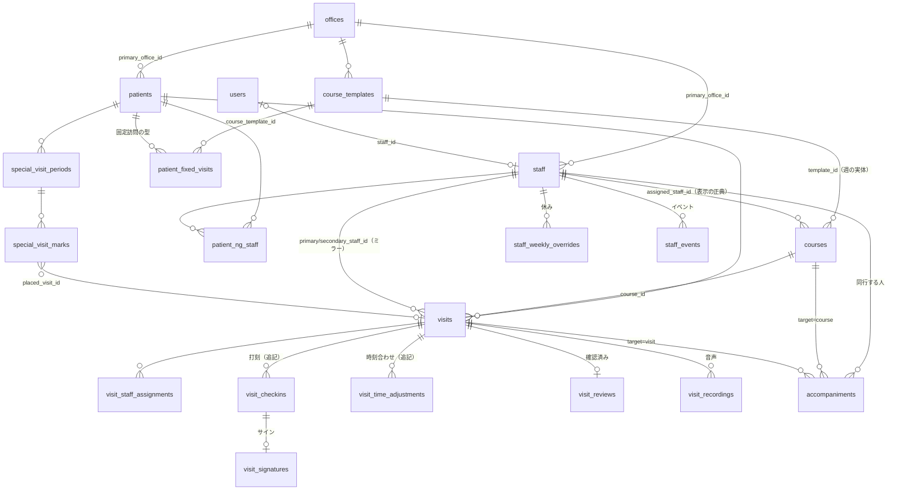

# R3 らく助（CareFlow）データの読み方ガイド — エージェントが「データの質問」に正しく答えるために

作成: 2026-10-12（読むだけの調査。コード・DB・サーバーには一切触れていない）
根拠: `backend/app/models/*.py`（55 テーブル）・`backend/alembic/versions`（head = **0090_visit_signatures**・90 本）・`backend/app/api/v1/*.py`・`docs/tools/week-leveling/extract.py`・`docs/tools/visit-history/extract.sql`・メモリ（careflow-staff-assignment-source / careflow-pin-consolidation ほか）・`docs/plans/session-2026-10-09-HANDOFF.md`

> **この文書の使い方（エージェント向けの決まり）**
> 1. まず §5 の **集計済み API** で答えられないか探す（数え方がアプリの画面と一致するため）。
> 2. API で届かないときだけ §4 の **読み取り専用 SQL** を使う。必ず `begin transaction read only;`（または `SET default_transaction_read_only = on;`）で流す。
> 3. 答える前に §3 の **落とし穴** を確認し、「何を数えたか」（取消を除く・同行を除く・【検証】を除く など）を答えに一言添える。

---

## 0. 接続のしかた（前提）

| 経路 | 内容 |
|---|---|
| API | `https://carelink.kaipoke-api.net/api/v1/...`（Cloudflare Tunnel）。管理者（`users.role='admin'`）の JWT が必要。staff ロールで呼ぶと **自分の分しか返らない** API が多い（visits・visit-history・dashboard/kpi など）。 |
| SQL（読むだけ） | `ssh root@72.60.211.213` → `docker exec -i carelink-postgres psql -U carelink -d carelink -v ON_ERROR_STOP=1 -At`。お手本 = `docs/tools/week-leveling/extract.py` の `_psql()`（本文の前に `begin transaction read only;` を付ける）。結果は `json_agg(row_to_json(x))` で 1 行 JSON にすると扱いやすい。 |
| 書き込み | **しない**。カイポケの RPA を動かす API（`/integrations/diff-local`・`/diff`・`/export`・`/smart-inbound-preview/start`・`/plan-actual-compare` など）も、カイポケ側にログインして画面を操作するので、エージェントが勝手に呼ばない（PO の了承が要る）。 |

---

## 1. テーブル一覧（55 本・用途・主な列と値）

### 1-1. 訪問（予定と実績の中心）

#### `visits` — 訪問 1 件 = 1 行（予定。実績は打刻テーブル側）
| 列 | 意味・値 |
|---|---|
| `patient_id` | 利用者（patients） |
| `visit_date` / `start_time` / `end_time` | **JST の壁時計**（タイムゾーンなしの date / time）。予定の時刻。実績で動かない |
| `status` | `planned`（予定）/ `in_progress`（到着済み）/ `completed`（退出済み）/ `cancelled`（取消）。DB に CHECK 無し |
| `source` | 出所。`auto`（週生成＝固定訪問の型から）/ `manual`（画面で手で追加）/ `manual_week`（「この週だけ」の配置・週のコピー）/ `manual_cancel`（らく助で「今週だけ取消」）/ `status_cancel`（患者を入院・終了などにしたときの自動取消）/ `import`（カイポケ取込）/ その他 `auto_alloc`・`fixed_fallback_preferred` 等の旧経路の値も残る。**実際の分布は `select source,count(*) from visits group by 1` で確かめる** |
| `week_pinned` | 青ピン（この週はこの位置のまま。週生成で消さない） |
| `is_unplanned` | 予定外訪問（予定の無い家で QR を読んでその場で作った訪問。`course_id` NULL・主担当＝読んだ人） |
| `primary_staff_id` | 主担当。**コース担当（`courses.assigned_staff_id`）のミラー**。週を作った直後は空でコースにだけ担当がいることがある |
| `secondary_staff_id` | 副担当（カイポケ取込の「1 訪問に職員 2 名」など） |
| `mentor_staff_id` | 旧メンター欄（ほぼ未使用。同行は `accompaniments` が正） |
| `course_id` | 週のコース（courses）。予定外・取込の一部は NULL |
| `required_staff_count` | 1 or 2（CHECK）。2 = 2 名体制 |
| `visit_group_id` | 2 名体制のペアキー。**同じ値の visit が 2 行**（各行に 1 人） |
| `manual_staff_override` | 手で担当を差し替えた（自動割当で上書きしない。コース担当と違っていてよい） |
| `kaipoke_id` / `kaipoke_service_override` | カイポケ側の ID / この 1 件だけのサービス内容の上書き |
| `type` | ほぼ `regular` |
| `deleted_at` | **ソフト削除**（NULL でないもの = 消した訪問。数えない） |

#### `visit_staff_assignments` — 訪問 × 職員（v2 の割当表・PK = visit_id+staff_id）
Layer3 の自動割当が書く。**表示の正典ではない**（§2 参照）。2 名体制では 1 visit に 1 行ずつ。

#### `courses` — 週のコース（1 週 × 1 曜日 × 拠点 × コード）
`iso_year`・`iso_week`・`weekday`（0=月〜6=日）・`code`（`A`〜`E` 通常 / `M`・`M2`〜`M9` マネージャー枠・あふれ / `臨`・`臨2`〜`臨9` カイポケ取込の臨時コース）・`office_id`・**`assigned_staff_id`（担当職員＝表示の正典）**・`course_status`（`proposed` 案 / `course_fixed` / `staff_assigned`）・`template_id`・`deleted_at`。
※ `proposed` は再計算の案。確定済みは `course_status <> 'proposed' and deleted_at is null`。

#### `course_templates` — 拠点ごとの恒久コース（A/B/C… のラベルと曜日別定員 `capacity_mon`〜`capacity_sun`）

#### `accompaniments` / `accompaniment_defaults` — 同行（新人同行・応援の同行）
- `accompaniments` = 週の実効リンク（**同行の唯一の正典**。visits の担当欄にも VSA にも書かない）。`accompanying_staff_id`（同行する人）・`target_type`（`course` = そのコースの全訪問に同行 / `visit` = その訪問だけ）・`course_id` or `visit_id`・`kind`（`trainee` 新人 / `support` 一般）・`source`（`default` 既定から展開 / `manual` 手で / `import` カイポケ取込の職員名 2 から）。
- `accompaniment_defaults` = 毎週の既定（職員 × 曜日 → コーステンプレート）。
- **同行は訪問の行を増やさない**（件数に入らない）。カイポケへは「職員名 2/3」として出る。

#### `patient_fixed_visits`（PFV）— 固定訪問の型（毎週の枠）
`patient_id`・`mode`（`normal` 通常週 / `special` 旧・置換型の特別週）・`weekday`（0=月）・`start_time`・`duration_min`・`slot_index`（0/1。2 名体制の患者は同曜日同時刻に 2 枠）・`course_template_id`（どのコースの枠か）・`sub_office_id`・`movability`（`unknown` 既定 / `time_flexible` 時刻だけ動かせる / `day_flexible` 曜日も可 / `locked` **赤ピン＝完全固定**）・`is_pinned`（`movability='locked'` の非推奨ミラー）。
週生成はここから `visits(source='auto')` を作る。**固定訪問が無い患者は週を作っても入らない**（例: 吉田様・冨山様）。

#### 訪問の付帯
| テーブル | 用途・主な列 |
|---|---|
| `visit_checkins` | **QR 打刻（追記専用）**。`visit_id`・`patient_id`・`staff_id`（読んだ人）・`kind`（`arrival` 到着 / `departure` 退出 / `no_show` 未訪問）・`scanned_at`（サーバ受信・本物の UTC 時刻）・`device_time`（端末で読んだ瞬間）・`lat`/`lng`/`accuracy_m`/`distance_m`（家からの距離）・`match_status`（`match` / `review` 要確認 / `mismatch` 場所違い / `no_gps`）・`is_override`（場所が違っても強行）・`checkin_source`（`qr` / `manual` 手入力 / `signature` サインで記録）・`reviewed_by/at`。再スキャンは新しい行。**kind ごとに最新 1 行を採る** |
| `visit_time_adjustments` | 実績の時刻を「合わせた」記録（追記専用）。`kind`（arrival/departure）・`adjusted_at`（合わせた時刻。NULL = 読取時刻に戻した）・`base_checkin_id`（NULL = 読み取りの無い退出を手で入れた）・`reason_code`（`intercom_wait` インターホン待ち / `read_later` 読み取りが後 / `no_read` 読み取りなし / `other`）・`source`（`mobile`/`pc`/`checkin`）・`created_by_*` |
| `visit_signatures` | サインの画像（退出打刻 1 行に 1 枚・`checkin_id` UNIQUE）。画像はファイル、5 年で画像だけ消す |
| `visit_reviews` | 訪問モニターの「確認済み」（1 visit 1 行・取消は物理削除）。`reviewed_by`・`comment` |
| `visit_recordings` | 音声記録（録音→文字起こし→要約）。`visit_id`/`patient_id`（NULL 可＝紐付け待ち）・`staff_id`・`recorded_at`・`status`（`uploaded`/`transcribing`/`summarized`/`failed`/`unlinked`）・`transcript`・`summary`（JSON: 主訴・様子 / バイタル / 処置・ケア / 申し送り / 次回）・`summary_text`・`cost_usd`・`deleted_at` |
| `visit_photos` | 訪問写真のメタ（`visit_id`・`caption`・`uploaded_by`） |

### 1-2. 利用者（患者）

#### `patients`
| 列 | 意味・値 |
|---|---|
| `code` / `name` / `kana` | 患者コード（P…）・氏名・かな |
| `status` | `active` 稼働中 / `suspended` 一時休止 / `admitted` **入院中** / `pending` 開始前 / `cancelled` **解約済み＝終了**（旧 `inactive` = 一時休止扱い） |
| `status_changed_at` / `_by` | 今のステータスになった時刻（UTC）と操作者。「入院中（9/8〜）」の根拠。mig 0082 以前は NULL |
| `sex` / `sex_restriction` | 性別 / 訪問者の性別制限（女性限定など） |
| `requires_multiple_staff` | 常に 2 名必須 |
| `insurance`（medical/care）・`visit_category`（`psychiatric` 精神科 / `general` 一般）・`kaipoke_service_content` | 請求・カイポケのサービス内容 |
| `primary_office_id` | **主担当拠点（拠点の正典）** |
| `address`・`lat`・`lng` | 住所・座標（移動・打刻の距離判定） |
| `weekly_pattern`（JSON） | 希望の訪問パターン（`service_minutes` など） |
| `special_weekly_pattern` / `special_week_active` / `special_week` | 旧・置換型の特別週（新機能は §特別訪問週間を使う） |
| `qr_token` / `qr_version` | 家に貼る QR |
| `deleted_at` | ソフト削除 |

関連: `patient_allowed_offices`（受け入れ可の拠点）・**`patient_ng_staff`**（NG 職員。行がある＝NG。`note` 理由・`decided_by_user_id`）・`patient_same_address_links`（同住所ペア `pair_mode` = `blocked` 同時訪問禁止 / `required` 必ず同時。行が無い＝`preferred`）・`revoked_qr_tokens`（再発行で失効した QR）。

#### 特別訪問週間（上乗せ型・現行）
- `special_visit_periods` — 患者ごとの期間。`start_date`〜`end_date`（含む）・`weekly_target`（週 N 回以上・既定 5）・`status`（`active` / `ended` / `cancelled`）。active は 1 患者 1 本。
- `special_visit_marks` — 週 × 曜日のセル。`kind`（`extra` ○ 追加枠 / `displaced` 固定訪問の日単位の退避）・`status`（`pool` 未配置 / `placed` 配置済み / `cancelled`）・`placed_visit_id`。**placed でも訪問が消えていれば未配置扱い**。
- 旧: `special_weeks` / `special_week_items`（ADD/REPLACE 型・ほぼ不使用）。

### 1-3. 職員

| テーブル | 用途・主な列 |
|---|---|
| `staff` | `code`（S…）・`name`・`kana`・`sex`・`status`（`active` / `on_leave` 休職 / `retired` 退職）・`role`（**業務ロール** `staff` / `manager`＝自動割当の対象外・救済枠。ログイン権限とは別）・`qualification`（看護師/准看護師/理学療法士…カイポケの職種）・`primary_office_id`・`is_trainee`（新人＝コースを持たず同行のみ）・`deleted_at` |
| `staff_secondary_offices` | 応援に入れる拠点 |
| `staff_shifts` | 曜日ごとの勤務（`weekday`・`is_on`・`start_time`・`end_time`） |
| `staff_weekly_overrides` | **休みの正典**（週 × 曜日）。`override_type` = `off` 終日休 / `am_off` 午前休 / `pm_off` 午後休 / `custom_time` 時間変更。`reason` |
| `staff_events` | 会議・研修・カイポケ個別業務など。`event_type`（`event` / `training`）・`starts_at`/`ends_at`（**注意: JST の壁時計を UTC として保存**）・`source`（`manual` / `kaipoke` 取込 / `fixed` 固定イベント展開）・`blocking`（🔒絶対に潰せない）・`cancelled_at`（今週だけ外す。行は消さない） |
| `staff_event_defaults` | 毎週の固定イベント（朝会など・月〜土） |
| `event_templates` | イベントのひな形 |
| `staff_shift_confirmations` | 月の出勤カレンダーを「確定して本人へ通知」した記録（`month` = 月初日・`confirmed_at`） |
| `shift_requests` | 月ごとのシフト希望（自由記述・`submitted`/`reviewed`） |
| `pending_requests` | 申請（`request_type` = `staff_off` 休み申請 / `staff_event` / `patient_cancel` / `patient_reschedule` ほか・`status` = `pending`/`approved`/`rejected`・`payload`・`target_staff_id`/`target_patient_id`/`target_date`・`applied_at`）。休み申請は承認で `staff_weekly_overrides` に入る |
| `users` | ログイン（`email` or `username`・`role` = `admin`/`staff`・`staff_id` で職員と 1 対 1・`deleted_at`） |

### 1-4. カイポケ連携

| テーブル | 用途・主な列 |
|---|---|
| `kaipoke_jobs` / `kaipoke_job_items` | RPA のジョブ（`job_type` fetch/push・`status` pending/running/completed/failed/cancelled・`week_start`・`params`（op = diff / apply / export / expand …）・`result_summary`）と明細（`status` success/excluded/unknown/failed…・`content`） |
| `correction_sheets` / `correction_sheet_items` | 差分シート（`direction` = `outbound` らく助→カイポケ / `inbound` カイポケ→らく助・`target_month`・`week_start/end`・`origin` NULL/`cached`/`reverse`）と明細（`action` add/edit/delete…・`before`/`after` JSON・`include` 送るか） |
| `kaipoke_csv_snapshots` | 最後に取ったカイポケ現況 CSV（`month`・`week_start`（週 CSV）/NULL（月 CSV）・`fetched_at`・`division` = `plan` 予定 / `actual` 実績）。**●未送信と突合レポートはこれを使う＝鮮度は `fetched_at` 次第** |
| `inbound_snapshots` | 取込の直前の週の盤面のバックアップ（週ごと 5 世代・`kind` diff/replace/smart） |
| `kaipoke_credentials` | カイポケのログイン情報（パスワードは暗号化・**読まない／答えない**） |

### 1-5. 設定・記録・その他

| テーブル | 用途 |
|---|---|
| `offices` / `office_cities` / `cities` | 拠点（`name` 稲毛/都賀…・`short_label` 稲/津・`kaipoke_name`・`operating_weekdays` 既定 [0..5]＝月〜土）と担当市区町村 |
| `scheduling_settings` | 移動の速さ・ゆとり・昼休み・営業時間・1 コース上限（1 行。NULL は既定値） |
| `checkin_settings` | 打刻の距離しきい値・遅刻判定など（1 行） |
| `business_profile` | 事業所名・電話（QR カード用・1 行） |
| `acceptance_calendar` / `acceptance_calendar_week` | 受け入れ枠（○△×・常設 / 週別） |
| `audit_logs` | 書き込み API の全記録（`actor_user_id`・`method`・`path`・`status_code`・`request_body`（伏せ字済み）・`created_at`）。「誰がいつ何をしたか」 |
| `schedule_op_log` | 盤面操作の undo/redo ジャーナル（`label` に「◯◯様を 火10:00→水14:00 に移動」等の日本語・`op_kind`・`iso_year/week`・`user_id`） |
| `notifications` | 利用者ごとの通知（`type`・`title`・`body`・`read_at`・`reference_type/id`） |
| `suggestion_dismissals` / `office_area_prompt_dismissals` / `office_feature_flags` / `geocoding_cache` | 提案の却下記憶・地域呼びかけの却下・機能フラグ・住所→座標キャッシュ（質問対象になりにくい） |

alembic との照合: モデルの 55 テーブルは migration と一致（`trainee_accompaniments`→`accompaniments` は改名、`ai_interpret_logs`・`mentor_assignments`・`staff_companion_assignments` は削除済み）。head = 0090（本番も 0090）。

---

## 2. つながり（ER の要約）と「正典」



### 正典（どれを信じるか）
| 知りたいこと | 正典 | 補足 |
|---|---|---|
| 訪問の担当（表示） | **`courses.assigned_staff_id`**。`visits.primary_staff_id` はそのミラー（手動差し替え `manual_staff_override=true` のときは visit 側が正） | アプリの集計（ダッシュボード・モニター）は「`primary_staff_id`、空ならコース担当（手動差し替えでない・コース未削除）」。SQL もこの式を使う: `coalesce(v.primary_staff_id, case when not v.manual_staff_override and c.deleted_at is null then c.assigned_staff_id end)`。VSA（visit_staff_assignments）は正典にしない |
| 同行 | `accompaniments`（course リンクは「そのコースの全訪問」に効く生きた参照） | visits の担当欄には入っていない |
| 毎週の型 | `patient_fixed_visits`（mode='normal'） | 週の実体は visits |
| 赤ピン / 青ピン | 赤 = `patient_fixed_visits.movability='locked'`（型）/ 青 = `visits.week_pinned`（その週の訪問） | 正典 = `docs/plans/pin-and-movability-spec.md` |
| 実績の時刻 | 調整があれば `visit_time_adjustments` の調整後、無ければ打刻の読取時刻（`device_time` が妥当ならそれ、そうでなければ `scanned_at`） | 唯一の実装 = `backend/app/services/checkin/actuals.py`。**SQL で再現すると細部（再送・圏外遅延・72 時間）がずれる → API を優先** |
| 患者の拠点 | `patients.primary_office_id` | 訪問の拠点は「コースの拠点、コース無しなら患者の主担当拠点」 |
| 休み | `staff_weekly_overrides`（`off`/`am_off`/`pm_off`） | 承認前の申請は `pending_requests`。イベント件名の「休み」「有給」は予備の判定 |
| カイポケ側の姿 | `kaipoke_csv_snapshots` の最新（`fetched_at` 時点の写し） | 写しより後にお客様がカイポケで直した分は見えない |

---

## 3. 正しく答えるための落とし穴

1. **時刻とタイムゾーン**
   - VPS とバックエンドは **UTC**（`TZ=UTC` はアプリの前提）。Postgres コンテナは `TZ=Asia/Tokyo` なので **psql の表示は JST**、`now()::date` も JST の日付になる。迷ったら明示する: `(now() at time zone 'Asia/Tokyo')::date`。
   - `visits.visit_date/start_time/end_time` は **JST の壁時計**（tz なし）。そのまま比べてよい。
   - `visit_checkins.scanned_at/device_time`・`created_at` 系は **本物の時刻（timestamptz）** → 表示は `at time zone 'Asia/Tokyo'`。
   - `staff_events.starts_at/ends_at` は **JST の壁時計を UTC として保存** → `starts_at at time zone 'UTC'` で壁時計に戻す（extract.py と同じ）。ここを JST 変換すると 9 時間ずれる。
   - cron・バックアップ名の時刻は UTC。
2. **ISO 週**: 月曜始まり。「週42」= 2026 年 ISO 第 42 週 = **10/12(月)〜10/18(日)**。`courses`・`staff_weekly_overrides`・`special_visit_marks` は `iso_year/iso_week` を持つ。年末年始は `iso_year` が暦年と違う。SQL: `date_trunc('week', d)::date` が月曜、`extract(isoyear from d)`・`extract(week from d)`。日曜はほぼ訪問なし（拠点の稼働は月〜土）。
3. **「来週の土曜」のあいまいさ**: 今日 10/12(月) なら「今週の土曜」= 10/17、「来週の土曜」= 10/24 が普通だが、人によって 10/17 の意味でも言う。**答えに日付を明記**し、あいまいなら両方示す。
4. **数える訪問の基本条件**: `v.deleted_at is null and v.status <> 'cancelled'`。取消（`cancelled`）は消しておらず残っているので、条件を忘れると件数が増える。取消の内訳は `source`（`manual_cancel` 今週だけ取消 / `status_cancel` 患者の非稼働化 / それ以外 = 取込の delete 由来など）で見分ける。**取消・削除された訪問にも打刻が残っている例がある**（打刻履歴は「打刻のある訪問」は取消・削除でも載せる）。
5. **数え方の約束（松岡様への回答・10/9）**: 件数は **同行を除く 1 回 1 件**。同行は別テーブルなので visits を数えれば自然に除かれる。職員の「担当件数」に同行を混ぜない（ダッシュボードも `accompany_visits` を別に出す）。
6. **2 名体制**: (a) Layer3 方式 = `visit_group_id` が同じ visit が 2 行、(b) カイポケ取込方式 = 1 行に `primary` と `secondary`。「回数」は `count(distinct coalesce(visit_group_id, id))` で 1 回に畳む。「職員ごとの担当件数」はそれぞれの人に 1 件ずつ。アプリのダッシュボード（kpi/trend）は **行数で数える**（(a) は 2 件になる）ので、違いが出たら説明する。本番で (a) がどれだけあるかは `select count(*) from visits where visit_group_id is not null and deleted_at is null` で確かめる。
7. **検証用データ**: 患者名が `【検証】…` で始まる架空患者（例「【検証】佐藤花子」）。**ダッシュボードは除外していない**（10/7 の完了 1 件が件数に入っている・未対応）。SQL では `p.name not like '【検証】%'` を付け、答えに「検証用を除く」と書く。検証用職員 S009 は退職（retired）済み。
8. **ソフト削除**: `visits`・`patients`・`staff`・`courses`・`course_templates`・`users`・`offices`・`visit_recordings` は `deleted_at`。必ず `deleted_at is null`。`patient_ng_staff`・同住所リンクは削除 API が明示的に消す。
9. **終了・入院の患者の訪問**: 患者を非稼働（入院・休止・開始前・終了）にすると **当日以降の予定は `status='cancelled', source='status_cancel'`**（10/9 からは終了時に予定と固定訪問の枠ごと消す選択肢あり）。過去の実績は残る。⭐（特別訪問）を「残す」を選んだ予定は planned のまま残ることがある → 「終了した人に予定が残っていないか」は `p.status<>'active' and v.status='planned' and v.visit_date >= 今日` で点検。
10. **新人（`is_trainee=true`）**: コースを持たない。担当件数は 0 で、同行（`accompaniments`）だけ。「小西さんの訪問数」は同行件数で答え、そう明記する。
11. **マネージャー（`staff.role='manager'`）**: 自動割当の対象外。`M` コースは「担当なし／あふれ」の入れ物でもある。
12. **担当なし**: `primary_staff_id` が NULL でもコース担当がいれば担当あり（ダッシュボード kpi の `today_unassigned` は primary だけを見るので多めに出ることがある）。本当の担当なし = 上の coalesce 式が NULL。
13. **カイポケの '-' 行（担当なし行）**: カイポケの CSV export は **職員名 1 が空の行を出さない**。担当なしの行はカイポケに存在しても突合に映らない → 「カイポケのみ」に出ない・「らく助のみ（add）」に化ける。担当なしの訪問をカイポケへ送るのはガードで止めている。
14. **カイポケとのずれの鮮度**: ●未送信・突合レポートは **最後に保存した現況 CSV** と比べる。保存より後にお客様がカイポケ画面で直した分（例: 週42 の約 45 件・10/7 以降）は見えない。答えに `fetched_at` を必ず添える。**月をまたぐ週は ●未送信が出ない**（誤情報防止のため空 + 警告）。過去日（当日以前）は送信対象外。
15. **名前の揺れ**: 齋藤/齊藤、髙梨/高梨、全角スペース有無。`replace(replace(name,' ',''),'　','')` で比べ、`kana` も使う。同姓が複数いれば候補を示して確認する（職員: 退職者も `staff` に残る → `status='active'` を優先）。
16. **打刻の「最新 1 行」**: 再スキャンは別行。到着時刻は kind ごとに最新を採る（同時刻なら `scanned_at desc, id desc`）。`no_show` は実績に数えない。`checkin_source='manual'`（手入力）・`'signature'`（サイン）は「QR で読んだ」ではない → QR 率の定義を答えに書く。
17. **staff ロールの見え方**: staff の JWT では visits / visit-history / kpi が自分の分に絞られる。全体の数は admin で取る。

---

## 4. よくある質問と答え方（44 問）

共通の土台 SQL（以下「有効訪問」）:
```sql
-- 有効訪問: 削除・取消を除き、検証用患者を除く。担当はコース担当で補う（アプリと同じ）。
with vv as (
  select v.*, p.name as patient_name, p.status as patient_status, p.primary_office_id,
         coalesce(v.primary_staff_id,
                  case when not v.manual_staff_override and c.deleted_at is null
                       then c.assigned_staff_id end) as owner_staff_id,
         c.code as course_code, coalesce(c.office_id, p.primary_office_id) as office_id
  from visits v
  join patients p on p.id = v.patient_id
  left join courses c on c.id = v.course_id
  where v.deleted_at is null and v.status <> 'cancelled'
    and p.name not like '【検証】%'
)
```

### A. 件数・予定

| # | 質問例 | いちばん良い答え方 | 注意 |
|---|---|---|---|
| 1 | 今日の訪問は何件？終わったのは？ | `GET /dashboard/kpi` → `today_visits`・`today_completed`・`today_unassigned`・`today_overlapping`・`this_week_visits`・`this_week_completion_rate` | 検証用を含む・2 名体制 (a) は 2 件・unassigned は primary だけで判定（§3-7,6,12） |
| 2 | 来週の土曜は何件？ | SQL: `vv` で `visit_date = '2026-10-24'` を `count(distinct coalesce(visit_group_id,id))`。または `GET /visits?week_start=2026-10-24&week_end=2026-10-24&limit=500` を数える | 日付を明記（§3-3）。週を作っていない週（週45〜）は 0 件＝「未作成」と答える |
| 3 | 週42 は全部で何件？曜日別は？ | SQL: `vv` で 10/12〜10/18、`group by visit_date`。表で見せるなら `GET /integrations/week-schedule?weekStart=2026-10-12&weekEnd=2026-10-18`（コース × 曜日） | ISO 週（§3-2） |
| 4 | 先週と比べて増えた？ / 直近 30 日の推移 | `GET /dashboard/trend?days=30`（日ごとの total/completed/unassigned） | 行数ベース（§3-6） |
| 5 | 今月の訪問件数（全体・拠点別） | SQL: `vv` で月の範囲、`group by office_id`（offices.name を join） | 拠点 = コースの拠点→患者の主担当拠点 |
| 6 | 田中さんの今月の訪問数 | **`GET /dashboard/staff-performance?from=2026-10-01&to=2026-10-31`** の `staff[].period.visits`（1 日あたり・利用者数・同行件数も） | 期間は最大 93 日。同行は `accompany_visits` に別（§3-5）。名前の同定（§3-15） |
| 7 | 田中さんの明日の予定（順番と時刻） | `GET /monitor?date=YYYY-MM-DD`（行＝職員・時刻順・コースの札付き）または `GET /visits?week_start=d&week_end=d&staff_id=…` | `/visits` の staff_id は primary/secondary/mentor の一致（同行は入らない）→ 同行は `GET /accompaniments?iso_year&iso_week&staff_id` を足す |
| 8 | いちばん訪問が多い人は？1 日あたりは？ | `GET /dashboard/staff-performance`（`per_day`・`days`） | 新人は担当 0（§3-10） |
| 9 | 担当が決まっていない訪問は？ | SQL: `vv where owner_staff_id is null and visit_date >= 今日` | kpi の値とずれる理由（§3-12） |
| 10 | 時間が重なっている訪問は？ | `GET /schedule/v2/feasibility-report?iso_year&iso_week&office_id&days=6`（移動・重なり・ゆとり・同住所。`format=html` で A4） | 読み取りのみ |
| 11 | この患者の次の訪問はいつ？ | SQL: `vv where patient_id=… and (visit_date, start_time) >= (今日, 今)` を昇順 limit 3。担当名は owner_staff_id を join | 週を作っていない先は出ない → 固定訪問の型（#12）で補足 |
| 12 | この患者の毎週の訪問（曜日・時刻・赤ピン） | `GET /patients/{id}/fixed-visits` | `mode='normal'` が通常週。`movability='locked'` = 赤ピン |
| 13 | この患者の今月の訪問回数 | SQL: `vv where patient_id=… and 月の範囲` で `count(distinct coalesce(visit_group_id,id))` | 1 回 1 件。過去分は実績（completed）と予定を分けて示すと親切 |
| 14 | コース A の担当は誰？（週・曜日） | `GET /courses?iso_year&iso_week&weekday`（`assigned_staff_id`）または `GET /schedule/v2/board?iso_year&iso_week&office_id` | proposed は案（§1-1 courses） |
| 15 | 週の健全性（未割当・定員超え・負荷の偏り） | `GET /schedule/v2/schedule-health?iso_year&iso_week`（推移は `/schedule-health/trend`） | admin |
| 16 | 入らなかった訪問（保留プール）は？ | 特別訪問週間の○は `GET /special-visit-marks/pool?iso_year&iso_week`。週の「入らない」訪問（ならし案のプール）は DB 上は削除された訪問なので、週のならし記録（runbook §7・HANDOFF）を参照 | プールの意味が文脈で違う。どちらか確認 |

### B. 実績・QR 打刻

| # | 質問例 | いちばん良い答え方 | 注意 |
|---|---|---|---|
| 17 | 山本様に昨日誰が何時に着いた？ | **`GET /visit-history?from=昨日&to=昨日&patient_id=…`**（`q=山本` でも可・2 文字以上）→ 到着の実績時刻・打刻した人・調整の有無・代行 | 実績時刻は調整後（§2）。SQL で出すなら下の「打刻 SQL」 |
| 18 | 今日の進み具合（今どこ・遅れ・未訪問） | `GET /monitor?date=今日&office_id=` → `phase`（future/awaiting/inprogress/done/missing）・`alert_level`（none/review/mismatch/missing）・`arrival_delay_min`・`stay_minutes` | 確認済み（reviewed）はアラートが消える |
| 19 | QR 打刻率は？（人別・全体） | `GET /dashboard/staff-performance` の `qr_ratio`（= 到着と退出が揃った訪問 ÷ 訪問）。到着だけの率は `GET /visit-history?from&to` の `summary.with_arrival / summary.visits` | **定義を必ず書く**（揃った率か到着率か・未来の予定は除外・手入力/サイン込みか）。QR 導入直後は低い（9 月下旬 ~10%） |
| 20 | 退出を記録し忘れた訪問は？ | `GET /visit-history?from&to&state=nodep` | 前日以前で到着のみ |
| 21 | 打刻が全く無い訪問は？ | `GET /visit-history?from&to&state=none` | 未来の予定は数えない |
| 22 | 担当外の人が行った（代行）・予定外の訪問は？ | `GET /visit-history?from&to&state=special` | 代行 = 到着を読んだ人が担当集合（主・副・割当・同行）の外 |
| 23 | 時刻を合わせた訪問とその理由は？ | `GET /visit-history?from&to&state=adjusted`。理由別の件数は SQL: `visit_time_adjustments` を `reason_code` で集計（最新行のみが有効） | 「直す/修正」でなく「合わせる/調整」と書く（PO の言葉づかい） |
| 24 | 平均の滞在時間は？予定より長い？ | `GET /dashboard/staff-performance` の `actual_min` と `plan_min` | 揃った訪問が 5 件未満なら null |
| 25 | 移動距離・1 日の内訳 | 同上 `km_per_day`・`travel_min_per_day`・`idle_min_per_day` | 直線距離・座標の無い区間は `skipped_legs` |
| 26 | 場所が違う打刻（要確認・場所違い）は？ | `GET /monitor?date=` の `alert_level` / SQL: `visit_checkins where match_status in ('review','mismatch')` | GPS が無い打刻は `no_gps` |
| 27 | 遅れて届いた打刻（圏外）は？ | `GET /visit-history?from&to&state=late` | 72 時間超は採らない |
| 28 | サインで記録した訪問は？ | SQL: `visit_checkins where checkin_source='signature'`（画像は `visit_signatures`） | 画像そのものは渡さない |
| 29 | この患者の最近の訪問の様子（音声記録の要約） | `GET /visit-recordings?patient_id=…&from&to` → `summary_text`、詳細 `GET /visit-recordings/{id}` | 個人の健康情報。必要最小限だけ答える |
| 30 | 月の打刻記録を印刷したい | `GET /visit-history/report?from&to&group=staff`（A4 HTML）/ `GET /visit-history/export`（Excel） | 92 日まで。出力は監査記録が残る |

打刻 SQL（API が使えないとき・調整の細則は省いた近似）:
```sql
with arr as (
  select distinct on (visit_id) visit_id, staff_id, coalesce(device_time, scanned_at) as read_at, match_status, checkin_source
  from visit_checkins where kind = 'arrival'
  order by visit_id, coalesce(device_time, scanned_at) desc, scanned_at desc, id desc),
adj as (
  select distinct on (visit_id) visit_id, adjusted_at, created_at, reason_code
  from visit_time_adjustments where kind = 'arrival'
  order by visit_id, created_at desc, id desc)
select v.visit_date, to_char(v.start_time,'HH24:MI') as 予定, p.name as 患者, s.name as 打刻した人,
       to_char(case when adj.adjusted_at is not null and adj.created_at > arr.read_at
                    then adj.adjusted_at else arr.read_at end at time zone 'Asia/Tokyo', 'HH24:MI') as 到着,
       arr.match_status, arr.checkin_source
from visits v join patients p on p.id = v.patient_id
left join arr on arr.visit_id = v.id left join staff s on s.id = arr.staff_id
left join adj on adj.visit_id = v.id
where v.visit_date = (now() at time zone 'Asia/Tokyo')::date - 1
  and replace(replace(p.name,' ',''),'　','') like '%山本%';
-- 取消・削除済みの訪問でも打刻があれば出す（事実を落とさない）。正確な実績時刻は API (/visit-history) を正とする。
```

### C. 患者マスター

| # | 質問例 | いちばん良い答え方 | 注意 |
|---|---|---|---|
| 31 | 入院中の患者は？いつから？ | SQL: `select name, code, (status_changed_at at time zone 'Asia/Tokyo')::date as since from patients where status='admitted' and deleted_at is null` | `GET /patients` は絞り込み引数が無い（limit/offset のみ・最大 500）→ 全件取って絞るか SQL。since が NULL = mig 0082 以前で不明 |
| 32 | 稼働中の患者は何人？拠点別は？ | SQL: `patients where status='active' and deleted_at is null and name not like '【検証】%' group by primary_office_id` | 開始前（pending）は数えない |
| 33 | 今月終了した患者は？ | SQL: `status='cancelled' and status_changed_at >= 月初(UTC 換算)` | 「解約済み」= 終了。終了者に予定が残っていないかも見る（§3-9） |
| 34 | 特別訪問週間中の患者は？ | `GET /special-visit-periods`（既定で active のみ）→ `start_date <= 今日 <= end_date` で絞る。今週の○の配置状況は `GET /special-visit-periods/{id}/calendar`・`GET /special-visit-marks/pool?iso_year&iso_week` | active でも期間外（開始前・終了日過ぎ）がありうる。旧・置換型（`special_week_active`）は別物 |
| 35 | この患者の NG 職員は？ | `GET /patients/{id}/ng-staff`（逆引き `GET /staff/{staff_id}/ng-patients`） | 理由メモ（note）は内部用。現場向けに出すか配慮 |
| 36 | 女性限定・2 名必須の患者は？ | SQL: `patients where sex_restriction is not null` / `requires_multiple_staff` | 値の表記は `select distinct sex_restriction` で確認 |
| 37 | 同じ建物の患者（同住所）は？ | `GET /patients/{id}/same-address-candidates`・`GET /patient-same-address-links` | 行が無い組は preferred（同時訪問を優先） |

### D. 職員・休み

| # | 質問例 | いちばん良い答え方 | 注意 |
|---|---|---|---|
| 38 | 今週休みの人は？ | `GET /staff/overrides-week?iso_year&iso_week`（`override_type` off/am_off/pm_off/custom_time） | 申請中は入らない（#39） |
| 39 | 未承認の休み申請は？ | `GET /pending-requests?status=pending&request_type=staff_off` | 1 日 = 1 件 |
| 40 | ◯月の出勤カレンダーは確定した？ | `GET /staff/{id}/shift-confirmations` | 再確定は同じ行の更新 |
| 41 | 田中さんの会議・研修の予定は？ | `GET /staff/{id}/events?from&to` | 時刻は壁時計（§3-1）。`cancelled_at` ありは「今週だけ外した」 |
| 42 | 新人の同行は今週どこ？ | `GET /accompaniments?iso_year&iso_week&staff_id=…` | course リンクはそのコースの全訪問 |

### E. カイポケ連携・記録

| # | 質問例 | いちばん良い答え方 | 注意 |
|---|---|---|---|
| 43 | カイポケとずれている訪問は？（週） | (1) **`POST /integrations/unsent-summary` body `{"weekStart":"YYYY-MM-DD"}`** = ●未送信（RPA を呼ばない・秒で返る・読み取りのみ。`items`・`sendable_count`・`past_count`・`snapshot.fetched_at`）。(2) 一覧表は `GET /integrations/reconcile-report?weekStart=…&format=json`（`counts` = 一致 / 相違 / らく助のみ / カイポケのみ / 非稼働患者） | 保存 CSV の鮮度（§3-14）・'-' 行（§3-13）・月またぎ週は空。**最新のカイポケを取り直す（`/diff-local` 等）は RPA を動かすので PO の了承なしに呼ばない** |
| 44 | ◯月の予定と実績（カイポケ）の食い違いは？ | `GET /integrations/plan-actual-report?month=YYYY-MM&format=json`（一致 / 時刻ズレ / 担当違い / 相違 / 予定のみ / 実績のみ・タグ 重複・職種未設定・同日複数） | スナップショットが無ければ 404（取得の `POST /plan-actual-compare` は RPA） |
| 45 | 最後にカイポケへ送ったのはいつ？結果は？ | `GET /integrations/jobs`（または `/integrations/kaipoke/jobs`）→ `GET /integrations/kaipoke/jobs/{id}/report`（連携結果レポート・success/excluded/unknown） | unknown = 要目視 |
| 46 | 取り込む前に戻せる？ | `GET /integrations/inbound-snapshots?weekStart=…`（5 世代） | 打刻のある週は戻せない |
| 47 | 誰がこの訪問を動かした？ | `GET /schedule/v2/op-log/state`（盤面操作・日本語ラベル）／ `GET /audit-logs?since&until&path=visits`（全書き込み API） | audit の request_body は伏せ字あり |
| 48 | 自分あての通知は？ | `GET /notifications?unread_only=true` | ログインした人の分だけ |

---

## 5. 集計済みの API（まずこちらを使う）

| API | 返すもの | 権限・制限 |
|---|---|---|
| `GET /dashboard/kpi` | 今日・今週の件数、完了、担当なし、重なり、今週の完了率 | admin（staff は自分の分） |
| `GET /dashboard/trend?days=1..90` | 日ごとの total / completed / unassigned | 同上 |
| `GET /dashboard/staff-performance?from&to&office_id` | 職員別・週別・チーム平均: 出勤日数・件数・利用者数・1 日あたり・予定/実績の分・QR 率・距離・1 日の内訳・未訪問・同行日数/件数 | admin・最大 93 日。担当 = primary→コース担当。取消・削除を除く。予定外を含む |
| `GET /monitor?date&office_id` | その日の職員別の訪問・打刻・遅れ・アラート・確認済み | admin/staff |
| `GET /visit-history?from&to&patient_id&office_id&staff_id&state&q&sort` | 1 行 = 1 訪問の実績（調整後）と `summary`（visits / with_arrival / with_departure / no_departure / none / adjusted）・グループ件数 | 最大 92 日・未来は集計外。`/report`（A4）・`/export`（Excel） |
| `GET /visits?week_start&week_end&staff_id&course_id&patient_id&limit≤500` | 訪問の生データ（名前付き） | staff は自分の分 |
| `GET /integrations/week-schedule?weekStart&weekEnd&officeId` | 週のコース × 曜日の表 | admin |
| `GET /schedule/v2/board?iso_year&iso_week&office_id` | 週の盤面（拠点 × 曜日 × コース） | admin/staff |
| `GET /schedule/v2/schedule-health`（+`/trend`・`/course-detail`） | 週の健全性 | admin |
| `GET /schedule/v2/feasibility-report?iso_year&iso_week&days&format` | 実現性（移動・重なり・バッファ・同住所）。A4 HTML あり | admin |
| `GET /schedule/v2/weekday-staff-capacity?iso_year&iso_week` | 拠点 × 曜日の出勤人数 | admin |
| `POST /integrations/unsent-summary {weekStart}` | ●未送信（保存 CSV とのローカル比較・RPA なし・書き込みなし） | admin |
| `GET /integrations/reconcile-report?weekStart&days&format` | らく助 × カイポケ 週突合（一致/相違/らく助のみ/カイポケのみ/非稼働） | admin |
| `GET /integrations/plan-actual-report?month&format` | 月の予定 × 実績（カイポケ） | admin |
| `GET /integrations/kaipoke/jobs/{id}/report` | 送信の結果レポート | admin |
| `GET /special-visit-periods`・`/special-visit-marks/pool` | 特別訪問週間・未配置の○ | admin |
| `GET /staff/overrides-week`・`/pending-requests`・`/accompaniments` | 休み・申請・同行 | admin |

**呼ばないもの（副作用・RPA）**: `POST /integrations/diff`・`/diff-local`・`/export`・`/apply`・`/expand`・`/smart-inbound-*`・`/replace-inbound`・`/apply-inbound`・`/plan-actual-compare`・`/master-reconcile`・`/events-*`、`/schedule/...` の生成・配置・割当系、`/patients/{id}/status-change`、`GET /integrations/credentials`（ログイン情報）。

---

## 6. 残る不確かさ（エージェントが確かめてから使うこと）

- `visits.source` の実際の値の分布（旧経路の値が残っている）→ 初回に `group by source` で確かめる。
- 2 名体制 (a)（visit_group_id）の本番での件数と、カイポケ送信時に 1 行か 2 行か（`csv_builder` は visit 行ごとに 1 行を出す作りに見える）→ 「回数」の答えでは 1 回に畳み、差が出たら注記。
- 「保留プール」の意味が会話によって違う（特別訪問週間の○ / ならし案で入らなかった訪問）→ どちらか聞く。
- ダッシュボードが【検証】患者を数えている問題・9 月の古い予定（9/1〜5）が残っている問題は未対応（`session-2026-10-09-HANDOFF.md` §4-4）。件数の質問ではこの 2 点を注記する。
